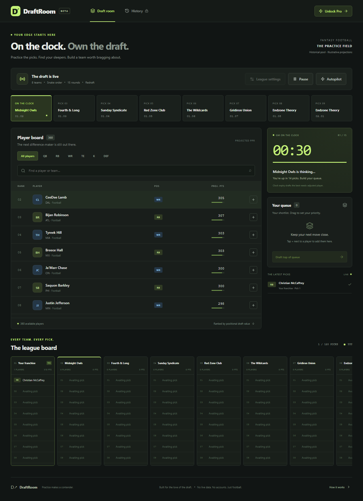

# DraftRoom

[](https://github.com/jevgenijostin/draftroom/actions/workflows/ci.yml)

A live fantasy-football mock draft desk. Practice a snake draft against deterministic opponent GMs, race a visible pick clock, curate your queue, and see every team's roster take shape. Built as an independent overnight MVP with React + Vite. No backend, runtime APIs, external fonts, accounts, or telemetry.

**[Live demo](https://jevgenijostin.github.io/draftroom/)** · [Repository](https://github.com/jevgenijostin/draftroom)



## Run locally

Use Node.js 24 and npm.

```sh
npm ci
npm run dev
```

Open the printed localhost URL. `npm run build` produces `dist/`; `npm run preview` serves that production build. Relative asset paths support GitHub Pages project URLs. All application data is bundled; after the static assets load, drafting needs no network requests. This is not an installable offline PWA.

## Your first draft

1. Open **League settings**. Default: 8 teams, 15 rounds, a 30-second clock, and your franchise in seat #1. Short 1/3/5-round practice sessions and 10/20-round drafts are also available. Clocks support 15/30/45/60 seconds.
2. Search or filter the 361-player/defense pool. Tap **+** to queue a player. Drag queue rows to reorder; up/down buttons provide keyboard and touch alternatives.
3. **Enter the draft**, then choose **Draft** beside any available player or **Draft top of queue**. Opponents take about 1.4 seconds per pick. Snake order reverses each round, including consecutive picks at the turn.
4. The real clock counts down and auto-picks the best needs-adjusted player at expiry. **Pause** freezes the room and clock. **Autopilot** runs all remaining picks quickly, honoring your queue on your turns. It can be stopped at any time.
5. Follow the live league roster board throughout. Finish for instant grades, explanations, and full rosters for every team.

The player pool contains real names and historical club associations, primarily from the 2024 era, including reserve and former players. **Ranks, draft values, and projected PPR points are illustrative generated practice data, not current NFL rosters, forecasts, or advice.** There is no live sports API or AI service.

## Free and Demo Pro

| Capability              | Free                             | Demo Pro                          |
| ----------------------- | -------------------------------- | --------------------------------- |
| Drafts                  | One per local calendar day       | Unlimited                         |
| League size             | 8 teams                          | 4–16 teams                        |
| Opponents               | Balanced deterministic heuristic | Custom position weights, 0.5–1.5× |
| Format                  | Redraft                          | Redraft and keeper seasons        |
| Completed draft history | None                             | Last 20 drafts in this browser    |

The free allowance is recorded when a draft starts, including an abandoned draft. Reloading does not restore an unfinished draft or refund the allowance. The daily check uses the device's local calendar date, not UTC. These are browser-local demo limits, not secure enforcement.

Click **Unlock Pro → Activate free demo license**, or paste this working key into the license field:

```text
DR1.d7550c16fc2eeeaaec5d2bf2970ef998902f6989269e6bf70f8bf51f3f379577
```

Generate the same key locally:

```sh
npm run generate-demo-license
```

Key format: `DR1.<64 lowercase hex characters>`. HMAC-SHA-256 signs the fixed `draftroom.pro.demo.v1` payload with a randomly generated, deliberately public 32-byte demo secret in `src/license.js`. Web Crypto verifies signatures; HTTPS or localhost is required. The secret is bundled in the browser, so anyone can mint keys or bypass local state. **This is a self-issuable monetization stub, not secure licensing or payment processing.** Activation persists in localStorage and is verified again on reload. There is no checkout, expiration, billing, or server entitlement service.

Completed Pro drafts are saved in localStorage. On the report, **Next keeper season** carries the two highest-value players from each roster into a new draft as bonus keepers. Keeper players are removed from the available pool; configured rounds are additional picks. This is a notional continuation with the same static pool, no aging or new rookie classes. A saved report can start another keeper season. Clearing browser storage removes the license, free-day record, and history. A storage write failure is surfaced to the user; the free draft cannot start if its usage record cannot be saved.

## Explainable GMs and grades

The engine distinguishes raw projected PPR points from positional **draft value**, so quarterbacks do not automatically consume the top of the board. AI scores each available player as:

```text
draft value × positional need × opponent position weight
```

An empty position gets 1.12×; depth gets 0.86×. At the soft targets of 2 QB, 5 RB, 5 WR, 1 TE, 1 K, 1 DEF, the multiplier drops to 0.12× and declines with each extra player. These are soft roster preferences, not hard lineup restrictions. Ties resolve by rank, making simulation deterministic. Clock fallback uses baseline needs-adjusted value, independent of the queue; the queue is honored by the explicit draft-queue button and autopilot.

Each pick records its baseline needs-adjusted value divided by that of the best available option at that exact pick, capped at 100%. A team's score is the rounded mean of those efficiencies: **A ≥93, B ≥83, C ≥73, D ≥60, otherwise F**. Every team uses baseline weights for grading, even if Pro changes opponent preferences. Keepers are excluded from new-season grades. Default AI is optimal under this deliberately simple yardstick and usually earns an A. Grades measure adherence to this heuristic, not predictive football success. Raw roster points include bench players and are not an optimized starting-lineup forecast.

## Tests and deployment

```sh
npm test
npx playwright install chromium
npm run test:e2e
```

On Linux, use `npx playwright install --with-deps chromium` when browser dependencies are needed. Playwright builds and starts the production preview automatically. `npm run format` formats the source and project files.

- **63 unit tests** cover snake order, invalid configurations, the player pool, positional weights and over-drafting, immutable picks, maximum-size completion, keeper exclusion, grade boundaries, queue ordering, HMAC generation/verification/tampering, and free-tier rules.
- **12 Chromium e2e tests** cover manual picks, actual clock ticks and expiry, pause/resume, drag reorder, accessible reorder/removal, draft completion and grades (including a full 120-pick draft), persisted daily caps, Pro settings/history, keeper continuation, invalid keys, filters/search, responsive layout, and zero external application requests/browser errors.
- GitHub Actions runs the same unit and browser suites on **ubuntu-latest and windows-latest**, retaining browser reports. Pages deploys only after both jobs pass. Set repository Pages source to **GitHub Actions**.

### Project map

| File             | Responsibility                                                               |
| ---------------- | ---------------------------------------------------------------------------- |
| `src/engine.js`  | Pure draft order, opponent choice, state transitions, grades, queue ordering |
| `src/players.js` | Bundled historical player pool and illustrative projections                  |
| `src/license.js` | Web Crypto HMAC and tier/configuration predicates                            |
| `src/storage.js` | Browser-local storage helpers                                                |
| `src/main.jsx`   | React draft desk, clock, queue, rosters, reports, settings/history           |
| `src/style.css`  | Responsive visual system, focus states, reduced-motion support               |
| `tests/`, `e2e/` | Unit and production-browser coverage                                         |

## Deliberately deferred

- Real payments, secure license enforcement, accounts, cloud sync, multiplayer human drafts, and a native mobile app.
- Current player feeds, injury updates, live rankings, news, real statistical projections, and LLM opponents.
- In-progress draft persistence, arbitrary human seat selection, trades, auction drafts, and hard roster/lineup validation.
- Full dynasty management, keeper selection UI, rookie classes, aging, season simulation, and deep league persistence.
- Export/import, undoing picks, and multiple human-controlled teams. Completed history stays in one browser and is capped at 20 drafts.
- Firefox/Safari certification and touch drag gestures. Chromium is tested; mobile users can reorder with the visible buttons. Desktop is the primary draft desk, with horizontal scrolling for larger league boards.

MIT licensed. Player names identify practice entries; no team logos, player photos, or league affiliation are implied.
